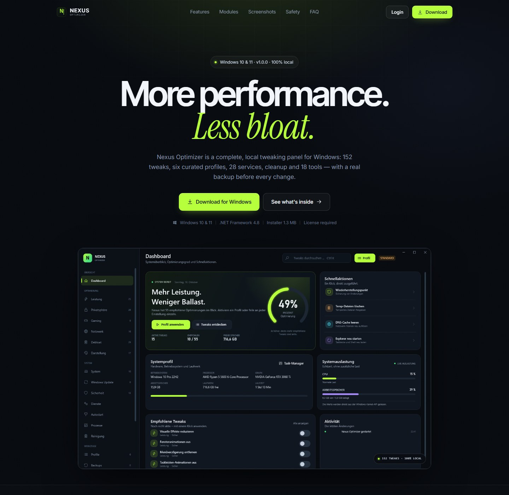

# Nexus Optimizer — Website

Marketing site for **Nexus Optimizer 1.0.0**, a local Windows tweaking panel with
152 tweaks, 6 profiles, 28 services, cleanup, backups and 18 tools. The site is in
English; the app screenshots are the real German UI.

The marketing page is static, but the **customer portal and license system need
the bundled Node 24 + SQLite server** in `server/`. See
[`server/README.md`](server/README.md) for setup, owner credentials, invites,
licenses and the activation API.



## Preview

For the full site including `/portal` and `/admin`, run the licensing server:

```powershell
cd C:\Users\seenx\Desktop\website\server
copy .env.example .env
# set OWNER_USERNAME=synx121, SESSION_SECRET and BASE_URL
node server.js
# http://localhost:3000
```

For the static marketing page only, `python -m http.server 8080` still works,
but the portal/admin links will not resolve without the Node server.

## Structure

```
index.html                    Landing page
impressum.html                Imprint (placeholder)
datenschutz.html              Privacy policy (placeholder) + license section
404.html                      Error page
site.webmanifest              Web app manifest
assets/
  css/style.css               Design system, responsive
  css/portal.css              Customer portal + admin styles
  js/main.js                  Module filters, menu, FAQ, reveals
  fonts/                      Self-hosted webfonts + OFL licenses
  favicon.ico                 App icon
  nexus-icon.png              App icon (256 px, header/footer)
  apple-touch-icon.png        iOS icon
  screenshots/                Real app screenshots
  og.png                      Social preview (1200 × 630)
downloads/
  NexusOptimizer-Setup.exe    Per-user installer with license gate
  NexusOptimizer.exe          Portable EXE with license gate
  NexusOptimizer-Setup.exe.sha256
preview.jpg                   Homepage screenshot
server/                       Node 24 + SQLite portal/licensing backend
  server.js                   HTTP server, portal, admin, API
  lib.js                      config, DB, scrypt, sessions, rate limit
  views.js                    server-rendered HTML
  set-password.js             local owner password reset (hidden prompt)
  .env.example                configuration template (no secrets)
  README.md                   setup, API, deployment
```

## Downloads

Both binaries are copied from `D:\HTL\optimizer\dist`. The installer SHA-256
shown on the page is verified against the shipped `.sha256` file:

```powershell
Get-FileHash .\downloads\NexusOptimizer-Setup.exe -Algorithm SHA256
```

The build is unsigned, so Windows SmartScreen may warn. Both binaries now include
the license gate: the app asks for a key on first start and validates it against
the server. Put `license-api.txt` containing the public server URL next to the EXE
(or set `NEXUS_LICENSE_API`); customers then only enter their key. Activation is
bound to a hardware ID, with a 7-day offline grace period.

The server stores **no plaintext owner password and no keys in source code**.
`OWNER_USERNAME=synx121` comes from the local `.env`; the owner password is
stored there and in `render.yaml` as a scrypt hash only. Change it locally with
`node server/set-password.js`. A fresh deployment that omits the hash uses the
one-time `/admin/setup` link instead.

## Interactions

- **Module filters:** All 18 / Optimize 10 / System 4 / Tools 4. All modules are
  visible in the “All” view; filters are keyboard accessible.
- **Screenshot gallery:** four real app screenshots, opening full size in a new
  tab.
- **FAQ:** accordion with one open answer at a time.
- **Mobile navigation:** full-screen menu with icon swap and scroll lock.
- **Customer portal & admin:** `/portal` (invite-only accounts, license keys,
  downloads) and `/admin` (owner-only invites/licenses/users). Served by the
  Node backend, not by a static host.
- **Scroll reveals** with `prefers-reduced-motion` support; content remains
  visible without JavaScript.

## Customising

### Colors and type

The palette is aligned with the app (`src/Theme.cs` in the Nexus project):

```css
--accent: #b6ff3c;
--bg:     #080b10;
--surface:#10161f;
--warn:   #ffb86b;
```

Fonts are self-hosted (Inter, Inter Tight, Instrument Serif) and can be swapped
in `assets/fonts/` and the `@font-face` rules.

### Content

- Module cards live in `index.html` under `#modules`; each card has a
  `data-category` (`optimize`, `system`, `tools`).
- Screenshots live in `assets/screenshots/` and are referenced from
  `#screenshots`.
- Download buttons point to `downloads/`. If you ship a new build, replace both
  EXEs, update the SHA-256 in `index.html`, and bump the version strings.
- The stats (152 / 6 / 28 / 18) come from the app README and module counts.

### Legal

`impressum.html` and `datenschutz.html` contain clearly marked **placeholders**.
Before publishing, replace provider details, contact email, hosting information
and the license section. Change `og:image` / `twitter:image` to an absolute URL
once the domain is known.

## Deployment

Deploy the whole project to a host that runs a long-lived **Node 24+** process
(Render, Railway, Fly.io, a VPS) so `/portal`, `/admin` and `/api/v1/*` work.
A `render.yaml` blueprint and `package.json` are included; Render creates the
service, persistent disk and environment variables. Set `BASE_URL` to the public
HTTPS URL if needed, use a persistent disk for `server/data/nexus.db`, and set
the environment variables from `.env`. See
[`server/README.md`](server/README.md).

A static-only host (Netlify static, GitHub Pages) can serve the marketing page
and downloads, but **not** the license portal or activation API.

## Credits

- App, screenshots and icon: Nexus Optimizer project (`D:\HTL\optimizer`).
- Website: synx121 — footer watermark links to <https://guns.lol/synx123>.
- Fonts: Inter, Inter Tight and Instrument Serif under SIL Open Font License 1.1
  (`assets/fonts/OFL.txt`).
